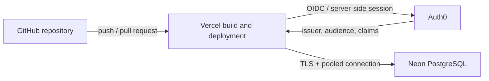

# 05 — Integrações

## Arquitetura de referência

## Configuração padrão inicial

- GitHub é a fonte de verdade do código e das migrations.
- Vercel executa build/deploy conforme branch e target de ambiente.
- Auth0 autentica usuários e emite tokens; a aplicação valida issuer, audience, assinatura e claims.
- O backend acessa Neon usando credencial server-side de privilégio mínimo.
- Segredos e endpoints são específicos por ambiente.

## Fluxos completos

### CI/CD

1. Pull Request executa lint, testes, typecheck, build e verificações de segurança.
2. Preview recebe configuração e banco isolados ou dados sintéticos.
3. Merge na branch de produção gera deployment de produção conforme política do repositório.
4. Migrations são aplicadas por etapa controlada antes/depois da promoção, conforme compatibilidade.
5. Verificar health checks, autenticação, acesso ao banco e logs após deploy.

### Autenticação e autorização

1. Navegador inicia login no fluxo recomendado pelo SDK.
2. Auth0 autentica e retorna para callback allowlisted.
3. Aplicação estabelece sessão segura e valida tokens no backend.
4. Autorização é aplicada no servidor com scopes/roles/permissions; ocultar botão no frontend não é controle de acesso.

### Acesso a dados

O cliente nunca recebe credenciais Neon. O backend valida identidade/autorização e executa queries parametrizadas. Se houver multi-tenancy, aplicar isolamento por tenant no servidor e avaliar RLS como camada adicional, com testes de bypass.

## Matriz de variáveis (nomes ilustrativos)

| Variável | Consumidor | Sensibilidade |
|---|---|---|
| AUTH0_SECRET | servidor web | segredo |
| AUTH0_BASE_URL | servidor web | configuração |
| AUTH0_ISSUER_BASE_URL | servidor web | configuração |
| AUTH0_CLIENT_ID | servidor web | identificador público do cliente |
| AUTH0_CLIENT_SECRET | servidor web | segredo |
| AUTH0_AUDIENCE | servidor/API | configuração |
| DATABASE_URL | servidor | segredo |

Validar os nomes exatos exigidos pela versão do SDK e pelo código da aplicação antes de configurar o projeto.